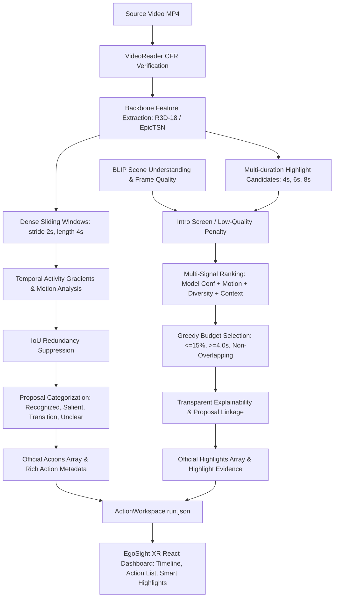

# Intelligent Temporal Action Proposals & Context-Aware Highlight Extraction Implementation Plan

> **For agentic workers:** REQUIRED SUB-SKILL: Use superpowers:subagent-driven-development (recommended) or superpowers:executing-plans to implement this plan task-by-task. Steps use checkbox (`- [ ]`) syntax for tracking.

This plan details the upgrade to EgoSight XR's temporal proposal generation and highlight extraction pipelines to satisfy all requirements of **Master Prompt 4**.

## Architecture & Data Flow Overview

---

## File Structure & Responsibilities

| File | Changes |
| :--- | :--- |
| `track4/code/egosight/proposals.py` (New) | Core proposal intelligence module: sliding-window sampling with stride 2.0s, activity score gradients, temporal continuity, NMS overlap suppression, quality ranking, and evidence-grounded proposal categorization. |
| `track4/code/egosight/pretrained.py` | Integrate `proposals.py` into `FPVTransfer.predict` and `EpicTSN.predict`. Retain raw candidates and structured proposals while adhering to Track 4 contract. |
| `track4/code/egosight/selection.py` | Upgrade highlight candidate evaluation: multi-duration candidate generation (4s, 6s, 8s), multi-signal ranking (confidence, motion, temporal diversity, intro-screen penalties), and transparent explanation generation. |
| `track4/code/egosight/pipeline.py` | Connect proposal metadata, highlight candidate generator, and provenance tracking. Ensure Track 4 schema compliance. |
| `backend/action_workspace.py` | Expose `action_metadata`, `proposal_stats`, and enriched `highlight_evidence` in `run.json` and API endpoints. |
| `frontend/src/egosight.tsx` & `egosight.css` | Enhanced timeline with multi-signal color-coded tracks, action proposals list with category pills & BLIP visual context, highlight cards with proposal links, and explainability cards. |
| `track4/tests/test_proposals.py` (New) | Unit tests verifying proposal categorization, NMS suppression, ranking, and non-overlapping invariants. |

---

## Proposed Tasks

### Task 1: Proposal Intelligence Engine (`track4/code/egosight/proposals.py` & unit tests)
- [ ] Implement `process_proposals(window_scores, duration, label)`:
  - Calculate temporal score gradients: $\Delta s_i = |s_i - s_{i-1}|$ and motion gradients $\Delta m_i = |m_i - m_{i-1}|$.
  - Calculate temporal stability via 3-point moving average.
  - Apply temporal Non-Maximum Suppression (NMS with IoU 0.35) to suppress redundant overlapping intervals while preserving distinct episodes.
  - Categorize proposals strictly grounded in evidence:
    - `Recognized action`: trained verb/noun head active (verb != 'other' or noun != 'other').
    - `Potential activity interval`: confidence $\ge 0.30$ and motion $\ge 0.03$.
    - `Activity transition`: boundary with $|\Delta s| \ge 0.15$ or $|\Delta m| \ge 0.06$.
    - `Visually unclear interval`: low motion ($< 0.02$) or confidence in $[0.10, 0.30)$.
  - Assign meaningful quality score and rank without fabricating probabilities.
- [ ] Write unit tests in `track4/tests/test_proposals.py` verifying NMS suppression, score gradients, and categorization.
- [ ] Run pytest to verify all tests pass.

### Task 2: Integrate Intelligent Proposals in `pretrained.py` & `pipeline.py`
- [ ] Update `FPVTransfer.predict` in `pretrained.py` to evaluate sliding windows at stride 2.0s, window 4.0s.
- [ ] Feed window scores and motion into `process_proposals`.
- [ ] Ensure `actions` returned satisfies Track 4 schema (`[{'start': s, 'end': e, 'verb': 'other', 'noun': 'other', 'confidence': float, 'visual': float}, ...]`).
- [ ] Attach `action_metadata` and `proposal_stats` (generated, retained, suppressed) to provenance.
- [ ] Run existing test suite to ensure 100% backward compatibility.

### Task 3: Context-Aware Highlight Extraction & Explainability (`selection.py`)
- [ ] Upgrade `select()` in `selection.py`:
  - Multi-duration candidate generation around proposal peaks (4s, 6s, 8s) when source duration permits.
  - Intro card penalty: penalize or exclude candidates in $0.0 - 4.0\text{s}$ if marked as title screen or low motion.
  - Multi-signal ranking: combine normalized confidence, motion salience, and temporal diversity (distance from previously selected highlights).
  - Enforce Track 4 constraints: strictly non-overlapping, $\ge 4.0\text{s}$, total duration $\le 0.15 \times \text{duration}$.
  - Link highlights to corresponding action proposals (`related_proposal_index`).
  - Generate human-readable, evidence-grounded selection explanations (`rationale`).
- [ ] Add unit tests in `track4/tests/test_selection_upgrade.py`.
- [ ] Run pytest to verify all tests pass.

### Task 4: Backend Workspace Integration (`backend/action_workspace.py`)
- [ ] Pass `action_metadata`, `proposal_stats`, and updated `highlight_evidence` into `run.json` record upon analysis completion.
- [ ] Ensure backward compatibility with existing saved runs.
- [ ] Test API endpoint `GET /api/action/runs/{id}` returns the enriched data.

### Task 5: Frontend UI Enhancement (`frontend/src/egosight.tsx` & `egosight.css`)
- [ ] Update Timeline:
  - Distinguish Recognized Actions (emerald), Potential/Salient Proposals (blue), Activity Transitions (amber), and Highlights (mint with subtle highlight border).
  - Add timeline legend for immediate readability.
- [ ] Update Action Proposals Sidebar:
  - Display category badges (`Recognized Action`, `Potential Activity`, `Activity Transition`, `Visually Unclear`).
  - Display confidence score %, interval time, and BLIP visual context quote.
  - Interactive click-to-seek.
- [ ] Update Smart Highlights:
  - Display `Related to Proposal #X` badge where linked.
  - Display duration, start/end timestamps, BLIP quote, and transparent selection explanation.
- [ ] Rebuild frontend (`npm run build`).

### Task 6: Evaluation on 5 Target Videos & Acceptance Verification
- [ ] Evaluate on:
  1. `Skate_el49s-RlIa4.mp4`
  2. `Surfing_7bzMGVKaiCQ.mp4`
  3. `RockClimbing_oVnAVcbMoSM.mp4`
  4. `P02_13.mp4` (EPIC-KITCHENS cooking)
  5. `Plane_UM3DZadX_o4.mp4`
- [ ] Record and report:
  - Generated proposals vs retained proposals.
  - Proposal rejection reasons (NMS redundancy suppression, low confidence).
  - Highlight candidates, selected highlights, durations, temporal diversity.
  - Actual selection explanations.
  - Verification against official Track 4 submission validator (`check_submission.py`).
- [ ] Capture live browser screenshots at `http://127.0.0.1:8502`.
- [ ] Complete delivery artifact and report findings to the user.
