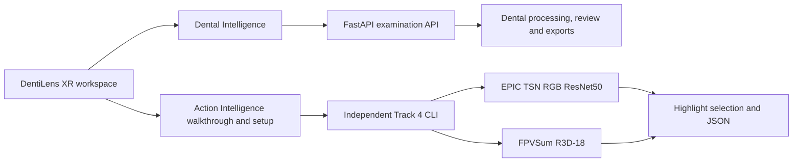

# DentiLens XR architecture

Both capabilities follow a video-to-timestamped-review workflow. The dental
React workspace, FastAPI backend and local examination records are independent
of the Track 4 CLI and its checkpoints. OpenCV is used in both paths. There
is no shared model or database.

| Path | Working prototype | Experimental or future |
| --- | --- | --- |
| Dental Intelligence | Upload, tooth overlays, timestamped review, bookmarks and exports | Model suggestions for tooth identity and instruments need review. Continuous headset capture and clinical validation are future work. |
| Action Intelligence | Offline EPIC verb–noun windows, FPVSum video categories, ranked highlights and Samsung JSON | Exact boundary detection, direct hand–object contact detection and headset deployment are future work. FPVSum does not emit verb–noun intervals. |

The [dental launcher](../run_full.sh) and [Track 4 launcher](../track4/run.sh)
retain their existing interfaces. The submission layout and setup are in the
[Track 4 documentation](../track4/README.md). Report local validation and
organizer scoring separately.
